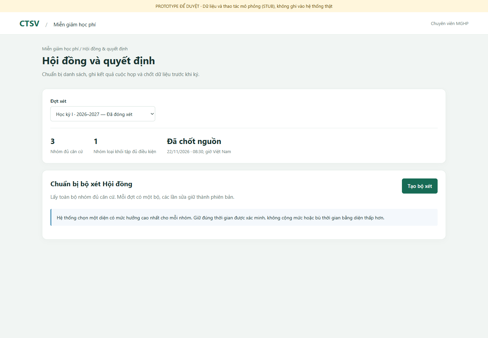
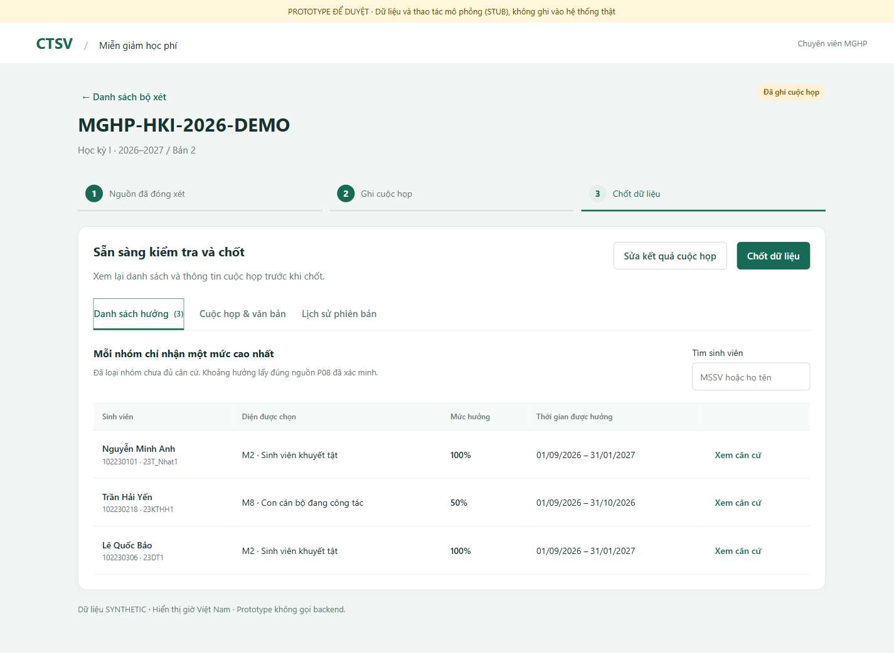

# P10 — Prototype riêng để duyệt

**Bộ ảnh đầy đủ cập nhật22/11:** [Mở gallery18ảnh](http://127.0.0.1:5180/gallery.html), hoặc mở [gallery.html](gallery.html) trong thư mục này. Có mục lục, nhấn từng ảnh để xem kích thước gốc. [Manifest](review-manifest.json) và [script chụp từng bước/tab](capture-review.mcp.js) ghi đúng dữ liệu synthetic và nội dung đã kiểm trước khi chụp.

Bao gồm nguồn đã Đóng xét → tạo bộ → danh sách/căn cứ trước họp → tab chưa ghi họp → form đã nhập → nội dung cuộc họp/văn bản sau lưu → danh sách/lịch sử sau họp → xác nhận chốt → **ba tab của bản đã chốt** → xem bản cũ chỉ đọc → danh sách bộ đã chốt → ba tab mobile. Bộ ảnh3file phía dưới là bản bàn giao ban đầu, không bao phủ đủ các màn hình; dùng gallery mới để review.

Mở http://127.0.0.1:5180/ khi server đang chạy. Nếu cần mở lại, cwd ctsv:
~~~powershell
node docs/prototypes/p10/serve.cjs
~~~
Server chỉ bind127.0.0.1, không deploy. Giữ thư mục trong repo để đọc tokens hiện hành; mở bằng file:// có thể không tải tokens.

1. Chọn Học kỳ I đã Đóng xét → Tạo bộ xét.
2. Xem từng căn cứ, tìm sinh viên.
3. Ghi kết quả cuộc họp thực tế, thử ngày tương lai để xem thông báo lỗi.
4. Xem bản sau họp và lịch sử; Chốt dữ liệu.
5. Thu màn hình xuống390px để review mobile.

Tất cả dữ liệu/thao tác **STUB**, không JWT/API/SQL. Refresh đặt lại mô phỏng. Backend P10 đã có kiểm HTTPS/SQL riêng; đây không là E2E app chính.
Chưa tích hợp React. Owner duyệt prototype mới chuyển phần đó sang feature MGHP/AppShell hiện hành.

Playwright MCP: chạy file verify.mcp.js qua browser_run_code_unsafe. Lần cuối22/11 có13assertions PASS, không JS exception; console navigation cuối0error/0warning.

[Ảnh mobile](03-locked-mobile.png)

[Báo cáo backend/evidence và giới hạn](../../p10-backend-prototype-report.md).

