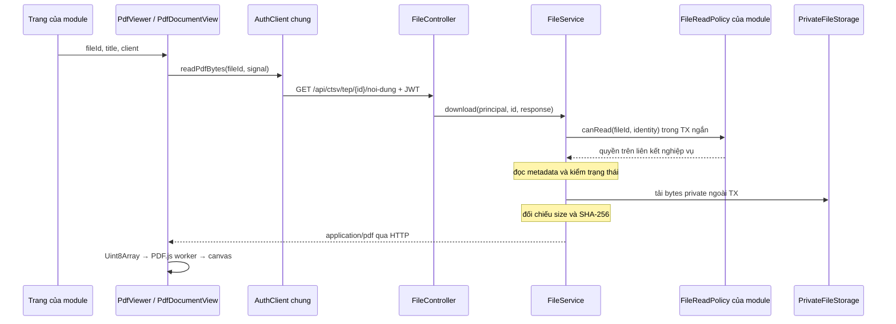

# Hướng dẫn dùng chung PDF.js, tải PDF có kiểm quyền và tích hợp ký số — CTSV

Component đã triển khai tại `frontend/src/shared/ui/pdf/`. Mọi module sử dụng cùng renderer; quyền và command nghiệp vụ vẫn do module/backend quyết định.

**Đối tượng đọc:** agent/thành viên tích hợp xem PDF hoặc ký số cho module khác trong cùng CTSV. Các đường dẫn source được đối chiếu ngày **25/11/2026**. Tài liệu mô tả code hiện có và cách tích hợp; không tự cấp quyền thay đổi module khác hoặc biến đề xuất thành chức năng đã triển khai.

## Đọc nhanh trước khi bắt đầu

| Nhu cầu | Tái sử dụng ngay | Phần module cần làm |
| --- | --- | --- |
| Chỉ xem/tải PDF | `PdfViewer`, AuthClient hiện có, API đọc file chung | Lấy fileId từ đối tượng nghiệp vụ; policy đọc đúng đối tượng nếu chưa có |
| Chọn vùng chữ ký | Chính `PdfViewer` với `selectable`, `PdfGeometry` | Quyền ký, người được giao, xác nhận và command nghiệp vụ |
| Gọi CA DUT | Bean `CaDutClient` cùng các kiểu/validator trong `shared.ca` | Điều phối, transaction ngắn, job bền vững, lịch sử và phục hồi theo contract của module |
| Lưu PDF kết quả | Public service `ManagedFiles` | Kiểm quyền trước khi đọc/lưu, gắn output vào đúng phiên bản/bước trong transaction của module |

**Điểm quan trọng:** đã có viewer và adapter CA dùng chung; **chưa có một signing engine công khai, độc lập module**. Những class `Signing*` trong feature/application nghiệp vụ là nguồn tham khảo luồng, không phải thư viện để module khác import hoặc copy nguyên khối. Xem §10–§12 trước khi tích hợp ký thật.

## 1. Luồng chuẩn

```text
Module chọn fileId từ API nghiệp vụ
  → AuthClient chung GET /api/ctsv/tep/{idTep}/noi-dung kèm JWT
  → Backend kiểm quyền trên file và kiểm toàn vẹn bytes private
  → Viewer nhận Uint8Array, PDF.js/worker render canvas
  → Người dùng chuyển trang, zoom, xoay hoặc tải chính bytes đang xem
```

Không đưa JWT vào URL, không mở CA/storage URL từ trình xem, không tạo Auth client riêng. Blob URL chỉ tạo tạm khi tải xuống, được thu hồi sau đó; không dùng iframe hoặc lưu PDF/token vào browser storage. PDF.js hiện hành **6.5.438** được tải khi mở PDF, dùng worker local do Vite đóng gói; không CDN và không thêm bản PDF.js khác cho từng module.

**Sửa lỗi scan24/11:** renderer cần cả decoder/font/CMap/ICC của đúng package. `frontend/tools/pdfjs-assets.mjs` phục vụ DEV và đóng gói build tại `pdfjs/<version>/`; `pdf-options.mjs` truyền `wasmUrl`, `standardFontDataUrl`, `cMapUrl`, `iccUrl` vào PDF.js. Không chỉ cấu hình worker: PDF.js6.5 dùng `jbig2.wasm` để giải mã cả ảnh CCITT Fax/JBIG2. Thiếu decoder có thể chỉ hiện logo/chữ ký hoặc trang trắng dù render promise hoàn tất. Giữ tên resource ổn định mà decoder yêu cầu, kèm license; không copy vendor binaries vào Git hoặc trỏ CDN.

Owner đã xác nhận không cần tìm chữ/bôi đen/sao chép trong lần chuyển đổi này. Chọn vùng ký là chế độ tùy chọn, không sửa bytes PDF và không gọi API ký.

## 2. Cấu trúc file và ownership

```text
frontend/src/shared/ui/pdf/
  index.ts                  # entry công khai, chỉ export viewer và types
  types.ts                  # PdfViewerProps / PdfGeometry
  PdfViewer.tsx             # entry React lazy + loading boundary
  PdfDocumentView.tsx        # PDF.js/worker, canvas/toolbar, overlay và vòng đời
  PdfViewer.module.css       # style cô lập, dùng design tokens hiện hành
  pdf-source.mjs            # GET qua AuthClient, MIME/bytes, AbortSignal
  pdf-options.mjs           # đường dẫn decoder/font/CMap/ICC đồng bộ phiên bản
  geometry.mjs              # pixel ↔ PDF points qua viewport
```

Module import entry `shared/ui/pdf`; không import renderer nội bộ, không import viewer từ feature khác, không copy worker/geometry/CSS. Shared không import `app` hoặc `features`, không biết tên module, role hay trạng thái nghiệp vụ.

| Viewer dùng chung | Module / backend |
| --- | --- |
| Tải đúng file, cancel/stale guards, loading/error/retry, render, toolbar, download và geometry | Danh sách, file được chọn, tên/ngữ cảnh, quyền và assignment |
| Trả vùng ký theo PDF points, hỗ trợ trang xoay/crop/zoom | Kiểm file/version/hash/ETag, xác nhận và command ký |
| Read-only mặc định, không tự gửi thao tác nghiệp vụ | Thứ tự người ký, CA adapter, lưu PDF sau từng bước, lịch sử và phục hồi |

## 3. Dùng để xem PDF

```tsx
import {PdfViewer} from '../../shared/ui/pdf'; // điều chỉnh mức ../ theo vị trí feature

<PdfViewer
  client={client}
  fileId={selectedFile.id}
  title={selectedFile.title}
  fileName={selectedFile.fileName}
/>
```

`client`, `fileId`, `title` là bắt buộc; `fileName` tùy chọn. Truyền instance AuthClient hiện có, ổn định. Viewer tải xuống bytes đã mở, không tạo GET thứ hai; module không cần truyền callback tải riêng.

Cập nhật tên/ETag hoặc đọc lại dữ liệu cha mà fileId không đổi sẽ giữ PDF đang xem. Không dùng `key` theo ETag/tên/metadata để ép viewer remount. Đổi file hủy request/render cũ, bỏ vùng ký cũ; trang hiện tại được giữ nếu còn hợp lệ, nếu không thì giới hạn theo số trang của file mới.

## 4. Dùng để chọn vùng ký

```tsx
import {useState} from 'react';
import {PdfViewer, type PdfGeometry} from '../../shared/ui/pdf';

const [selection, setSelection] = useState<PdfGeometry | null>(null);

<PdfViewer
  client={client}
  fileId={currentFile.id}
  title={currentFile.title}
  fileName={currentFile.fileName}
  selectable={canPlaceSignature}
  selection={selection}
  onSelectionChange={setSelection}
/>
```

`canPlaceSignature` lấy từ điều kiện quyền/bước/file hiện hành của module, không suy từ tên role. Viewer chỉ hiện công cụ khi có `selectable=true` và callback; **không cấp quyền ký**. Backend phải kiểm lại quyền trên file, assignment, version/hash, ETag và geometry khi nhận command.

```ts
type PdfGeometry = {
  page: number;  // bắt đầu từ 1
  x: number; y: number; width: number; height: number; // PDF points
};
```

Người dùng chuyển trang → chọn vị trí → kéo vùng → di chuyển/resize → module xác nhận và gửi command riêng. Xoay/zoom/resize màn hình chỉ đổi cách hiển thị; geometry giữ theo PDF points. Chuyển trang hoặc file bỏ selection; phiên bản/bước/ETag đổi thì module cũng phải bỏ xác nhận cũ theo nghiệp vụ. Read-only không có overlay hoặc nút chọn vị trí.

Không cho viewer tự upload, ký CA, retry command hoặc quyết định thời điểm chuyển người ký. Việc dùng viewer chung không triển khai chức năng ký cho module chưa có contract/backend.

## 5. Vòng đời và xử lý lỗi

- Fetch phụ thuộc client ổn định, fileId và lần retry; không phụ thuộc object cha.
- Abort request cũ, kiểm abort cả sau khi đọc bytes; không hiện response cũ dưới tên file mới.
- Cancel render cũ và chờ kết thúc trước khi dùng lại canvas; destroy loading task khi đổi file/unmount. Tương thích React StrictMode.
- PDF.js chuyển buffer sang worker; giữ bản bytes riêng cho download. Không cache toàn cục hoặc ghi bytes/base64/JWT vào storage/log.
- Lỗi tải/render hiện ngay trong viewer, có **Thử mở lại PDF**; chỉ GET lại khi người dùng chủ động.
- Lỗi vùng quá nhỏ hiện cạnh công cụ chọn; người dùng chọn lại ngay, không tải lại PDF.
- Màn hình nhỏ cuộn trong vùng PDF khi zoom; không làm tràn toàn trang. Toolbar và trạng thái dùng CSS Modules/design tokens.

| Tình huống | Xử lý |
| --- | --- |
| 401 / token bị thu hồi | AuthClient chung xử lý phiên; không tạo vòng refresh riêng |
| 403 / 404 | Không hiện bytes cũ hay mở storage URL thay thế; giữ thông báo đúng phạm vi |
| File chưa sẵn sàng / kiểm toàn vẹn lỗi / storage lỗi | Không giả thành công; cho đọc lại theo contract và lỗi trả về |
| Đổi file hoặc rời màn hình khi đang tải | Hủy request/render; không hiện lỗi giả cho file tiếp theo |
| Retry thành công | Hiện đúng PDF mới tải, không yêu cầu gửi lại lệnh nghiệp vụ |

## 6. API và quyền của module mới

Endpoint đã có: `GET /api/ctsv/tep/{idTep}/noi-dung`, không query/body; response `application/pdf`, `Cache-Control: no-store`, `Content-Disposition: attachment`. Renderer dùng bytes nên không cần đổi header thành inline.

**Dùng cùng viewer không có nghĩa mọi loại file đã được backend cấp quyền.** Module mới phải có quan hệ file–đối tượng, nguồn capability và policy đọc đúng contract. Nếu chưa có, ghi dependency và phối hợp shared/backend; không mở quyền chung hoặc tạo endpoint tải song song để chữa lỗi viewer.

Điểm đọc source:

- [FileController](../src/main/java/pbl6/ctsv/shared/files/FileController.java): JWT, route và PDF response.
- [FileService](../src/main/java/pbl6/ctsv/shared/files/FileService.java), [FileReadPolicy](../src/main/java/pbl6/ctsv/shared/files/FileReadPolicy.java): kiểm quyền và policy extension hiện hành.
- [FileMetadata](../src/main/java/pbl6/ctsv/shared/files/FileMetadata.java), [ManagedFiles](../src/main/java/pbl6/ctsv/shared/files/ManagedFiles.java): metadata và interface file backend.
- [PrivateFileStorage](../src/main/java/pbl6/ctsv/shared/files/PrivateFileStorage.java), [PdfSpool](../src/main/java/pbl6/ctsv/shared/files/PdfSpool.java): storage private và kiểm toàn vẹn/tài nguyên.

## 7. Checklist cho module tích hợp

- [ ] Lấy fileId/tên từ backend, không bắt người dùng nhập ID.
- [ ] Xem A→B→C→D và đổi nhanh, đúng tên/bytes/canvas; không giới hạn số tài liệu.
- [ ] Download khớp SHA-256 của tài liệu đang xem, không tạo GET PDF thừa.
- [ ] Metadata refresh không remount/tải PDF lại.
- [ ] Loading/error/retry/unmount và StrictMode không để stale response hoặc render cạnh tranh.
- [ ] Read-only không có công cụ ký; chế độ ký chuyển đúng page/point theo zoom/rotation/crop.
- [ ] Backend kiểm cả quyền đối tượng và URL trực tiếp; không suy quyền từ việc ẩn nút.
- [ ] Desktop/mobile xem được nội dung thực; screenshot đã được xem, canvas có nội dung chứ không chỉ tồn tại.
- [ ] PDF scan nhiều trang phải có nội dung ở thân trang, không chỉ header/logo/chữ ký. Không có warning `Unable to decode image`/`JBig2 failed`; decoder request200. Chạy thêm `pdf-scan-regression.mcp.js` với fixture35trang và đối chiếu ảnh tham chiếu.
- [ ] Dùng ứng dụng/DB được phép, fixture đã có; không upload/ký lại cho ca chỉ kiểm viewer.
- [ ] Ghi riêng REAL/STUB và phạm vi chưa kiểm; không coi component harness là bằng chứng toàn bộ nghiệp vụ ký của một module.

## 8. Bằng chứng và chạy lại kiểm thử

[Plan và kết quả chuyển đổi](superpowers/plans/2026-11-23-shared-pdfjs.md). Unit: `node --test tests/shared-pdf.test.mjs` tại `frontend/`. Build/typecheck: `npm.cmd run build`.

Browser: `frontend/e2e/shared-pdf-login.cjs` tái sử dụng năm context DEV hiện có trên CDP loopback 9337, credential DPAPI → RAM; module Playwright/cert qua environment local, không storageState. `shared-pdf-setup.mcp.js` gắn các phiên và tạo harness. `shared-pdf-dev.mcp.js` chạy từng `page.__sharedPdf.stage`: source, selection, consumers, permissions, review-fixes. Nếu Vite reload làm mất harness, chạy setup lại trong cùng phiên RAM. Giữ context khi lỗi, sửa và chạy lại đúng stage.

`shared-pdf-harness.html/tsx` chỉ là fixture E2E, không được build thành route sản phẩm. Nó dùng PDF được backend thật cho phép đọc; chế độ chọn vùng ở harness không gọi command ký hoặc chứng minh quyền ký nghiệp vụ. Các màn hình thực được kiểm riêng trong stage consumers/permissions.

Kết quả sửa lỗi scan và phân biệt dữ liệu mẫu thiếu file: [báo cáo24/11](pdf-rendering-fix-20261124.md). Không coi metadata-only fixture là PDF đã lưu thật hoặc bỏ kiểm toàn vẹn để làm mẫu đó xem được.

## 9. Luồng xem PDF: đi qua từng file FE và class BE



### 9.1 Frontend

Tất cả đường dẫn dưới đây tính từ root repo `ctsv`:

| Thứ tự | File | Trách nhiệm |
| --- | --- | --- |
| 1 | Trang trong `frontend/src/features/<module>/` | Chọn file từ DTO của backend; truyền AuthClient đang dùng. Không tự lấy URL Cloudinary/CA |
| 2 | `frontend/src/shared/ui/pdf/index.ts` | Entry công khai export `PdfViewer`, `PdfGeometry`, `PdfViewerProps` |
| 3 | `frontend/src/shared/ui/pdf/PdfViewer.tsx` | `lazy`/`Suspense` nạp renderer khi cần |
| 4 | `frontend/src/shared/ui/pdf/PdfDocumentView.tsx` | Quản lý tải/render/cancel, trang/zoom/xoay, download và overlay chọn vùng |
| 5 | `frontend/src/shared/ui/pdf/pdf-source.mjs` | `readPdfBytes(client,fileId,signal)` gọi API chung, kiểm MIME và dấu `%PDF-`; đây không phải kiểm chữ ký mật mã |
| 6 | `frontend/src/shared/auth/auth-client.mjs` | `client.request()` bổ sung JWT, xử lý refresh chung, lỗi HTTP; không tự retry lệnh ghi. `shared/auth-client.mjs` chỉ là compatibility re-export |
| 7 | `frontend/src/shared/ui/pdf/pdf-options.mjs`, `geometry.mjs` | Tài nguyên PDF.js và đổi tọa độ, không biết nghiệp vụ |
| Build/DEV | `frontend/tools/pdfjs-assets.mjs`, `frontend/vite.config.ts` | Phục vụ/đóng gói resources của đúng `pdfjs-dist` đang cài |

`AuthClient` type nằm tại `frontend/src/shared/types/api.ts`. Không tạo instance mới ở mỗi render; nhận client từ cơ chế cấp client hiện có của ứng dụng.

**Khác luồng iframe cũ:** PDF hiện được render bằng PDF.js/canvas từ `Uint8Array`, không gắn Blob URL vào iframe. Blob URL chỉ được tạo tạm cho chức năng tải file đang xem rồi thu hồi. Không quay lại iframe riêng cho mỗi module.

### 9.2 Backend

Các file ở `src/main/java/pbl6/ctsv/shared/files/`:

| Class/interface | Công việc và ranh giới |
| --- | --- |
| `FileController` | Nhận đúng một Bearer header, gọi `AuthAccess.verifyAccessToken`, kiểm ID/path/query/body, trả PDF bằng callback của service |
| `FileService.download` | TX ngắn xác định identity, metadata, policy đọc và trạng thái; sau TX mới tải storage, đối chiếu size/hash rồi ghi response |
| `FileReadPolicy` | **Public extension point**: `boolean canRead(long fileId, FoundationAccess.Identity identity)`. Module tự triển khai quyền trên liên kết file–đối tượng của mình |
| `FileMetadata` | Nội bộ: đọc/ghi metadata, liên kết đã có và kiểm tra tệp. Không import trực tiếp từ module khác |
| `PrivateFileStorage` | Public interface `upload`, `download`, `find`, `cloud`, `publicId`; không chứa phân quyền nghiệp vụ |
| `CloudinaryFileStorage` | Adapter storage đang dùng, giữ tài nguyên `raw`/`authenticated`; credential chỉ ở backend |
| `PdfSpool` | Nội bộ: file tạm có giới hạn size/concurrency; đóng lease sẽ xóa file tạm |
| `PdfValidation` | Nội bộ: parse/kiểm cấu trúc PDF khi ghi file |
| `UploadLedger` | Nội bộ: trạng thái lượt upload/phục hồi, không phải bảng hay repository để module khác tự ghi |
| `FileProblem`, `FileErrors` | Lỗi an toàn của API file; không trả credential/storage URL tùy ý |
| `FileConfiguration` | Bean/CORS/multipart/reconciliation chung, bật bằng `ctsv.files.enabled`; Cloudinary có cấu hình riêng |
| `ManagedFiles` | Public application boundary cho service/worker: metadata, đọc bytes đã kiểm toàn vẹn, lưu output có operation ID (§11) |

**Quyền đọc là OR giữa các policy:** `FileService` thử `policies.orderedStream().anyMatch(...)`; nếu không policy nào cấp thì mới dùng fallback đã có. Vì vậy policy của module phải trả `false` với mọi file không thuộc phạm vi mình, không cấp quyền bằng câu “đúng role thì đọc tất cả”. Trả `false` không phải cơ chế phủ quyết quyền đã được policy khác cấp. Không đăng ký hai policy chồng chéo vô tình mở rộng quyền.

`canRead` được gọi trong transaction của API file: chỉ đọc quyền/liên kết trong DB, không gọi CA/Cloudinary hoặc mở transaction network tại đây. Không nhét SQL truy cập bảng module khác vào `shared.files` để tạo một nhánh đặc biệt cho mỗi module.

**Upload chưa phải API dùng cho mọi module:** `POST /api/ctsv/tep/van-ban` hiện kiểm role chuyên viên của module đã triển khai; `/minh-chung` hiện yêu cầu identity sinh viên. `FileMetadata.links`/fallback cũng có các quan hệ hiện hữu cụ thể. URL chung không bảo đảm mọi người dùng của module mới được upload. Nếu cần mở rộng, chốt contract/quyền và phối hợp thay đổi shared trước; không cấp role sai, bỏ guard hoặc copy controller để vượt qua.

## 10. Luồng ký số đang có: phần chung và phần tham khảo

### 10.1 Hành trình thực tế

1. Backend nghiệp vụ trả tài liệu/phiên bản, input file/hash, người được giao/bước hiện tại, quyền thao tác và ETag.
2. Trang hiển thị PDF **tại CTSV** qua viewer chung. Người ký tự chọn trang, kéo/di chuyển/resize vùng.
3. Module mở hộp xác nhận. Người dùng chỉ xác nhận bước của mình; FE gửi **một command đến CTSV**, không gọi CA trực tiếp.
4. Backend kiểm JWT/quyền/assignment/thứ tự/ETag, đọc input từ `ManagedFiles`, kiểm geometry bằng `CaPdfPreflight`; tải file ngoài TX, kiểm CAS lần nữa trong TX trước khi enqueue.
5. TX SQL lưu lượt việc, input hash, vùng ký và sự chấp thuận. HTTP trả **202 đã tiếp nhận**, chưa phải đã ký xong.
6. Worker backend tiếp tục ngoài vòng đời trang: lấy chứng thư, chuẩn bị tài liệu CA, gọi ký, ghi receipt/checkpoint, tải output và kiểm toàn vẹn/chữ ký.
7. Lưu **một file output riêng cho mỗi bước** tại CTSV qua `ManagedFiles.store`, commit metadata/liên kết/trạng thái/lịch sử. Chỉ sau đó mới chuyển bước.
8. FE đọc/poll tiến độ. Đổi trang hoặc đóng viewer không hủy công việc đã được DB tiếp nhận. Người tiếp theo phải tự mở đúng output và xác nhận bước của họ.

Với người thứ hai, input phải là **PDF output người thứ nhất đã lưu tại CTSV**. Worker hiện có thể dùng cùng `document_id` nếu bytes CA khớp hash input. Khi CA trả 404 trước khi gửi ký bước sau, có thể upload đúng bản input đã có chữ ký; lỗi mạng/5xx hoặc hash sai không được coi là 404 để upload lại tùy tiện.

### 10.2 Adapter CA dùng chung

Đường dẫn: `src/main/java/pbl6/ctsv/shared/ca/`.

| Class | Public API/trách nhiệm hiện có |
| --- | --- |
| `CaDutConfiguration` | Tạo bean `CaDutClient` khi `ca-dut.enabled=true`; cấu hình `CA_DUT_URL`, `CA_DUT_CLIENT_ID`, `CA_DUT_CLIENT_SECRET` ở môi trường, không ghi giá trị vào code/tài liệu |
| `CaDutClient` | `categories()`, `certificates(email)`, `templates(email)`, `upload(input,title,category)`, `sign(document,certificate,email,name,box)`, `download(document)` |
| `CaTokenManager` | Cache token trong RAM của client, giữ `receivedAt`/`expiresAt` từ JWT `exp`; chỉ làm mới khi cần gọi mà còn **không quá 5 phút**, không phải refresh định kỳ 5 phút. Refresh thất bại không tiếp tục dùng cache mơ hồ |
| `CaProviderDtos` | Kiểu receipt/certificate/upload/result của adapter. Không cho FE tự gửi các giá trị này để thay kết quả CA |
| `CaSignerBinding` | Đối chiếu danh tính/chứng thư và dữ liệu consent. API Client dùng chung không đồng nghĩa được ký thay chủ chứng thư |
| `CaPdfPreflight` | `inspect(bytes, Box)` kiểm PDF, giới hạn, trang, crop/rotation và vùng; `sha256(bytes)`. `Box` dùng page từ 1, PDF points/gốc dưới-trái trước display rotation |
| `CaPdfSignatureVerifier` | Kiểm CMS/ByteRange và tính toàn vẹn chữ ký nhúng offline; **không chứng minh PKI trust hoặc giá trị pháp lý**. Không thêm external pin/trust gate đã bị loại |
| `CaFailure` | Code an toàn, HTTP status, cờ uncertain; không dump raw body/token vào log |
| `CaSigningSequence` | Helper spike có thể tham khảo; không phải worker/queue/engine sản phẩm chung và không thay consent từng người |

Quy tắc tích hợp giữ nguyên:

- Inject bean `CaDutClient` dùng chung, không tạo client/token cache riêng cho từng request/module, không sửa origin theo dữ liệu FE.
- `certificates(email)` luôn truyền `status=active`; vẫn kiểm ngày hiệu lực, `is_valid`, `has_private_key` và lựa chọn đúng người. Không tự chọn ngẫu nhiên nếu có nhiều chứng thư phù hợp.
- Không gửi `user_signature_id`; CA dùng mẫu mặc định. `templates()` tồn tại để tham chiếu, không là bước bắt buộc của mỗi lượt ký.
- `CaDutClient` hiện không có method cấp/gia hạn/thu hồi chứng thư. Prototype Admin hoặc tài liệu API của provider không có nghĩa các thao tác đó đã được CTSV triển khai.
- CA client tự quản token CA; AuthClient FE quản JWT CTSV. Đây là hai lớp token khác nhau.
- GET có retry giới hạn trong adapter; POST có side effect được dispatch một lần. Không bọc `upload`/`sign` bằng retry tổng quát hoặc gọi lại sau timeout để “chắc ăn”.
- Adapter hiện allowlist code lỗi, không chuyển mọi thông báo 400 raw thành tiếng Việt sẵn. Nếu cần chi tiết mới, phải bổ sung contract/error mapping đã lọc an toàn, không hứa FE hiện được toàn bộ response của CA.

### 10.3 Các class FE/BE điều phối hiện hữu — chỉ tham khảo

Các đường dẫn có tên module sau đây là **vị trí source thực tế để đọc**, không phải dependency công khai cho module khác, không mang quy trình/chức danh của module đó sang module mới.

| Đường dẫn | Công việc |
| --- | --- |
| `frontend/src/features/mghp/signing/SigningBundle.tsx` | Upload, gắn PDF vào bộ dữ liệu/phiên bản; giữ fileId nếu upload đã thành công nhưng bind lỗi |
| `frontend/src/features/mghp/signing/SigningWorkspace.tsx` | Danh sách → chi tiết → `PdfViewer` → xác nhận → gửi command → poll; xem output/lịch sử. `selectionKey` thay thì xóa vùng/ACK cũ |
| `frontend/src/features/mghp/signing/SigningDialog.tsx` | Hộp xác nhận của feature, chưa phải shared component |
| `frontend/src/features/mghp/signing/api.mjs`, `model.mjs`, `types.ts` | Adapter endpoint, If-Match/ETag, DTO và quy tắc hiển thị của feature; không import sang module khác |
| `src/main/java/pbl6/ctsv/mghp/application/SigningController.java` | HTTP/read/prepare/enqueue/reconcile; nhận JWT/If-Match, trả ETag và 202 khi enqueue |
| Cùng package: `SigningDocuments` | Gắn file vào version/nguồn đã được chốt, không sửa đè bản trước |
| `SigningAccess` | Capability/assignment, quyền đọc tài liệu, triển khai `FileReadPolicy`, quyền worker sau consent |
| `SigningService` | Chuẩn bị plan, kiểm command/geometry/CAS, enqueue và phục hồi theo điều kiện hiện hành |
| `SigningWorker`, `SigningScheduler` | Claim/lease và xử lý checkpoint ngoài request trình duyệt; scheduler tick những việc DB cho phép |
| `SigningProvider`, `SigningProviderConfiguration` | Port của module, production delegate sang `CaDutClient`; không phải port shared dùng xuyên module |
| `SigningArtifacts` | Kiểm input/output hash, revision nối tiếp và chữ ký cũ/mới trước `ManagedFiles.store` |
| `SigningReads`, `SigningRules`, `SigningOptions`, `SigningAuthorizations` | Read model, invariant, cấu hình người ký và bằng chứng ủy quyền theo module |
| `SigningRepository`, `SigningEntities` | Persistence/checkpoint nội bộ. Không truy cập xuyên module hoặc ghi SQL trực tiếp để “gắn ké” một tài liệu mới |

Các route như `/api/ctsv/yeu-cau-ky/{id}/gui-ky` hoặc `/tai-lieu-ky` tuy có tên chung hiện vẫn do controller/service trên sở hữu. Không mặc định chúng đã hỗ trợ loại văn bản/module mới, không đăng ký controller trùng route hoặc tái sử dụng request ID ngoài phạm vi được cấp.

Worker đã nhận công việc dùng boundary `AuthAccess.requireAcceptedWorkAccess` qua `SigningAccess.acceptedActor`, không phụ thuộc vào một JWT browser còn sống suốt lúc gọi CA. Đây **không phải** cách xác thực endpoint HTTP; HTTP vẫn kiểm token như bình thường. Worker vẫn kiểm tài khoản/quyền/assignment/nguồn và không được dùng cơ chế này để ký khi chưa có consent bền vững. Sau khi đã có receipt ký thành công, cần bảo toàn/lưu output, không vứt kết quả chỉ vì người dùng rời phiên.

## 11. Dùng `ManagedFiles` đúng cách trong service/worker

Public methods hiện có, không cần dựng thêm file service riêng:

```java
ManagedFiles.Info describe(long id);
ManagedFiles.Pdf read(long id);
ManagedFiles.Info store(UUID operation, long owner, byte[] bytes, String name);
Optional<ManagedFiles.Info> committed(UUID operation, long owner, String hash);
```

- `describe` trả metadata, **không tự chứng minh người gọi được đọc file**.
- `read` kiểm private storage/size/hash nhưng caller phải authorize đối tượng trước; đây không phải endpoint công khai thay `FileController`.
- `store` nhận owner đã được server xác định và operation UUID ổn định được DB lưu trước. Không lấy owner từ request FE, không `UUID.randomUUID()` lại mỗi lần phục hồi cùng một output.
- `committed` giúp tìm output đã commit theo operation/owner/hash, tránh gọi CA hoặc upload mới khi đang phục hồi.
- `read`/`store` tự chặn nếu đang có SQL transaction hoạt động. Không đặt cả method điều phối dưới `@Transactional` rồi gọi chúng; dùng các `TransactionTemplate` ngắn trước/sau network.
- `store` dùng khóa và upload ledger/key xác định theo operation. Lần đã có ý định upload sẽ đối chiếu `find` để nhận lại asset thay vì POST mù; không coi điều đó là mọi lỗi đều được retry tự động.
- Sau khi lưu file, module phải commit liên kết output vào đúng bước/phiên bản. Chỉ có một row metadata/URL cloud chưa đủ để báo tài liệu hoàn tất.

**Giới hạn hiện tại cần biết:** `PdfSpool` hiện là file **tạm**, tự xóa khi đóng lease. `ManagedFiles.store` đang dùng spool này; `SigningWorker` nhận bytes output rồi gọi lưu. Cơ chế giữ PDF bền trên ổ đĩa backend khi lỗi cho Admin xử lý đang ở **kế hoạch/prototype**, chưa được tích hợp hệ thống chính trong lượt tài liệu này. Không ghi trong tài liệu/module mới rằng đã có durable disk recovery. Nếu cần khả năng đó, phải chốt public boundary dùng chung trước, không tự tạo mỗi module một spool/cleanup engine.

## 12. Module mới áp dụng thế nào để không dư thừa/conflict?

### 12.1 Chỉ xem PDF: tích hợp nhỏ nhất

1. Đọc contract của module để biết fileId và quyền trên đối tượng.
2. Nếu quyền GET file đã đáp ứng, chỉ import `PdfViewer` như §3. Không cần migration, worker hoặc thay shared.
3. Nếu quyền chưa đáp ứng, thêm **policy trong package của module**, implement interface public `FileReadPolicy`. Kiểm liên kết thực tới đối tượng mà actor được xem; thử cả file ngoài module, file khác chủ và direct URL. Không tự mở rộng fallback chung.
4. Dùng client/renderer/assets hiện có. Route/menu/bố cục thuộc feature và AppShell chung.

Khung policy dưới đây là **pseudocode thích nghi**, không phải API đã tồn tại để copy/compile nguyên trạng:

```text
<Module>FileReadPolicy implements FileReadPolicy
  canRead(fileId, identity):
    tìm liên kết fileId → đối tượng trong chính module
    nếu không có: false
    kiểm identity/capability + quyền đọc đối tượng + phạm vi/phiên bản
    trả kết quả; không gọi network
```

### 12.2 Chọn vùng: FE dùng chung, command do feature định nghĩa

Ví dụ React nhận callback để module nối vào **API đã được duyệt của chính mình**, không tự phát minh endpoint ký mới:

```tsx
import {useEffect, useState} from 'react';
import {PdfViewer, type PdfGeometry} from '../../shared/ui/pdf';
import type {AuthClient} from '../../shared/types/api';

type Props = {
  client: AuthClient;
  file: {id: string; title: string; fileName: string};
  contextKey: string; // file/hash/version/bước/ETag hiện hành từ feature
  canSign: boolean;   // feature ánh xạ capability/assignment từ backend
  busy: boolean;
  onReviewSelection: (geometry: PdfGeometry) => void;
};

export function DocumentPanel(p: Props) {
  const [selection, setSelection] = useState<PdfGeometry | null>(null);
  useEffect(() => setSelection(null), [p.file.id, p.contextKey]);
  return <>
    <PdfViewer client={p.client} fileId={p.file.id}
      title={p.file.title} fileName={p.file.fileName}
      selectable={p.canSign && !p.busy}
      selection={selection} onSelectionChange={setSelection}/>
    {p.canSign && <button disabled={p.busy || !selection}
      onClick={() => selection && p.onReviewSelection(selection)}>
      Xác nhận vị trí ký
    </button>}
  </>;
}
```

Điều chỉnh mức `../` theo thư mục của feature. Callback mở dialog review tài liệu/phiên bản/người ký; sau consent mới gửi command bằng AuthClient và ETag snapshot. `PdfGeometry` đi tới backend dưới dạng PDF points, backend parse PDF kiểm lại, rồi adapter mới ánh xạ `page → page_number`, `x → pos_x`, `y → pos_y`. Không nhân pixel/zoom lần thứ hai hoặc tự đảo trục Y.

**Đây chỉ là ví dụ vùng ký**, không cung cấp queue, luật role/ACK, trạng thái tài liệu hay quyền ký. Không gọi shared validator/CA trực tiếp từ FE, không auto ký người tiếp theo. Không dùng state của nút làm bảo đảm chống gửi trùng; backend phải kiểm CAS/job/bước.

### 12.3 Ký thật: làm theo thứ tự, không dựng engine song song

1. Chốt contract module: loại tài liệu, nguồn/version bất biến, người được giao/thứ tự/consent, quyền đọc output, ETag/idempotency, checkpoint và lỗi/phục hồi.
2. Kiểm các public boundary §9–§11. Ghi rõ khoảng thiếu, nhất là upload quyền mới, gắn tài liệu và orchestration hiện chưa generic.
3. Phối hợp owner shared để quyết định **mở rộng boundary hiện có hay tách orchestration dùng chung**. Đây là việc cần scope/review riêng; tài liệu này không tự tạo engine/class/schema mới.
4. Module giữ nguồn nghiệp vụ, capability/assignment, DTO/command, policy đọc và liên kết đối tượng. Code kỹ thuật chung chỉ có một nơi, không copy viewer/CA/token/storage/hash/geometry sang module.
5. Nếu backend chung được mở rộng, dùng public interface/DTO; không phụ thuộc vào repository/entity/application nội bộ của module tham khảo. Không tạo hướng phụ thuộc Shared → feature/module.
6. Xác minh module tắt/bật, permission/direct URL, recovery và regression consumer hiện có trước tích hợp. Phối hợp migration chung khi thật sự cần, không dành số version bằng phỏng đoán.

### 12.4 Quy tắc tránh conflict khi các agent cùng làm

| Được làm trong feature/module được giao | Phải phối hợp trước khi sửa |
| --- | --- |
| Component trang, adapter contract module, state điều hướng, policy đọc riêng | `shared/ui/pdf`, AuthClient, worker/resources/Vite và dependency lockfile chung |
| Entity/repository do module sở hữu theo schema đã duyệt | `shared.files`, `shared.ca`, API file chung, auth/public signing boundary |
| Test fixture/case của module đúng đích được phép | Shared table, upload ledger, signing schema/history, Flyway version và route đã có |

- Không cài thêm PDF.js/worker hoặc SDK Cloudinary/CA cho từng module; một bản dependency/asset pipeline cho frontend chung.
- Không đổi GlobalWorkerOptions ở một feature, thêm CDN/font/cMap riêng hoặc CSS global tác động canvas module khác.
- Không tạo endpoint thứ hai trả cùng PDF chỉ để chữa quyền; không sửa hash/size DB để file hỏng tải được.
- Không sửa migration đã áp dụng, chạy lại SQL đổi tên, tạo Flyway history riêng trong cùng CTSV; chỉ dùng chuỗi/version chung theo quy trình nhóm.
- Không tạo app/router/navbar/Auth riêng. Không sửa module tham khảo để test của module mình xanh.
- Tài liệu này là hướng dẫn kỹ thuật, không quyết định thứ tự/chức danh ký hoặc trạng thái nghiệp vụ cho module khác.

## 13. Lỗi và kiểm chứng khi áp dụng

| Tình huống | Điều cần kiểm/giữ |
| --- | --- |
| Canvas chỉ hiện logo, trang sau trắng | Resource decoder/font/CMap/ICC đúng bản và request200; xem nội dung thân trang của PDF scan, không chỉ kiểm render promise |
| `FILE_INTEGRITY_FAILED` | Metadata/size/hash/asset/bytes của đúng file; không bỏ integrity guard. Có thể fixture metadata không có PDF thật |
| File khác không tải được hoặc403/404 | Policy file–đối tượng và capability thật, không suy lỗi viewer hay đưa storage URL ra FE |
| Chọn nhanh A→B→C→D | Tên/fileId/canvas phải khớp; request cũ bị hủy, render cũ không ghi lên canvas mới |
| Stale ETag/phiên bản | Không tự lấy ETag mới rồi gửi lại consent cũ; đọc đúng PDF, xóa vùng/ACK cũ, người dùng xác nhận lại |
| CA success nhưng không tải/lưu được PDF | Giữ receipt/checkpoint, không báo hoàn tất/chuyển bước; phục hồi tải/lưu kết quả, không POST ký lại |
| SQL rollback sau CA/storage | Không hoàn tác HTTP ngoài hệ thống; tìm lại theo operation/receipt/key, không tạo lượt ký/upload mới tùy tiện |
| Mất response ký | CA có response success/failed nhưng CTSV chưa nhận được; giữ bằng chứng kỹ thuật, không tự ký lại |

Checklist bàn giao cho agent của module:

- [ ] Ghi source/contract và fileId/quyền được dùng; xác định phần chung sẵn có và gap cần phối hợp.
- [ ] Chỉ xem: test nhiều PDF khác nhau, PDF scan nhiều trang, chuyển trang/zoom/rotation, đổi nhanh file và download bytes khớp.
- [ ] Chọn vùng: trang2+, zoom/rotation/crop, resize màn hình và selection reset khi file/version/bước thay đổi; backend từ chối geometry sai.
- [ ] Quyền: tài khoản được cấp và thiếu quyền, chủ khác, đối tượng ngoài phạm vi, direct URL, module bật/tắt. Không dùng một dataset một chủ sở hữu để kết luận chặn truy cập chéo.
- [ ] Ký: bấm trùng/stale CAS, người chưa tới lượt, output mỗi bước, người sau dùng đúng bản người trước, rời trang/đăng nhập lại không hủy accepted work hoặc tạo job trùng.
- [ ] Lỗi: cert/upload/sign/download/storage/SQL, success nhưng chưa có PDF, response chưa rõ; chỉ retry phần an toàn và đủ bằng chứng.
- [ ] SQL/HTTP/security/concurrency theo phạm vi đã duyệt; browser thật với FE/BE/DB được phép. CA thật chỉ chạy khi được cấp quyền, không ký/upload lại cho test điều hướng.
- [ ] Báo riêng source review / unit hoặc stub / HTTP SQL thật / CA Cloudinary thật / browser; không dùng một kết quả thay cho tất cả.

**Phạm vi kiểm chứng của lần cập nhật hướng dẫn 25/11/2026:** đối chiếu source và public signatures/đường dẫn/link của tài liệu. Không sửa logic, không chạy DB/CA, không triển khai hoặc xác nhận integration của module mới. Mọi kế hoạch/prototype Admin/PDF lưu chờ phải được nghiệm thu và tích hợp riêng trước khi coi là hạ tầng có sẵn.
